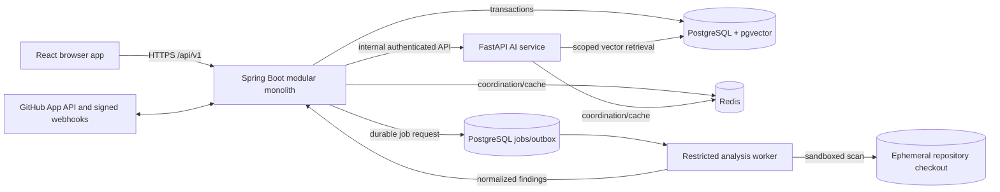

# Architecture overview

## Stage 1 implementation

`backend/` now contains one Spring Boot application with `auth`, `user`, `project`, `github`, and `common` packages. Controllers accept/return DTO records, services perform use cases, repositories own JPA access, and Flyway owns schema changes. Stage 1 has no AI service, analysis worker, durable job implementation, or frontend. The diagram below remains the target architecture. Browser-to-Spring and Spring-to-PostgreSQL paths passed live checks; Spring-to-GitHub passed local mock HTTP tests. See [Stage 1 implementation](stage-1-implementation.md) for remaining limits.

## System shape

The Spring Boot modular monolith is the public API and system of record. The separately deployable FastAPI service handles AI-specific processing. React calls the Spring API only. PostgreSQL stores business data, job state, and pgvector embeddings; Redis coordinates short-lived work and caching. Code analysis runs in isolated workers when implemented, never inside a web server or on the application host.

The AI service's direct database access is limited to explicitly scoped retrieval tables and a dedicated least-privilege database role. Spring owns schema migrations, authorization decisions, and job lifecycle. If preserving this boundary is simpler through an internal retrieval API, use that instead; do not let the AI service update users, projects, or integrations.

## Backend modules

| Module | Owns | Public dependency surface |
| --- | --- | --- |
| `identity` | User identity, sessions, roles, project membership checks | `CurrentActor`, authorization policy |
| `projects` | Projects, membership lifecycle, project settings | Project service and DTOs |
| `github` | App installation, webhook verification, token exchange, repository/PR metadata sync | Integration events and GitHub port |
| `repositories` | Repository selection, immutable commit snapshots, ingestion requests | Repository query and ingestion service |
| `analysis` | Analysis requests, findings, scan provenance, PR review state | Analysis service and result DTOs |
| `jobs` | Durable job state, outbox, retries, deduplication | Job submission/status port |
| `audit` | Security and business audit events | Append-only audit port |
| `shared` | Small cross-cutting types, validation, error envelope, correlation IDs | No business logic |

Within each module use `api` (controllers/DTOs), `application` (use cases), `domain` (rules and ports), and `infrastructure` (JPA/HTTP/queue adapters). Controllers depend on application services; domain code does not depend on Spring or JPA. Modules communicate through declared interfaces/events, not each other's entities or repositories. Keep one deployable backend artifact and one schema migration stream.

## AI service modules

| Module | Owns |
| --- | --- |
| `ingestion` | Safe file selection, parsing, chunking, line mapping, embedding requests |
| `retrieval` | Project- and commit-scoped vector search and citation assembly |
| `explanation` | Grounded code answers and provenance checking |
| `review` | AI review orchestration over pinned PR diffs and scan findings |
| `test_generation` | Proposed test patches and validation metadata |
| `providers` | AI model and embedding provider adapters, rate limiting, cost tracking |
| `contracts` | Internal DTOs, authentication, error handling, health/readiness |

## Trust and data flows

1. The browser authenticates with Spring. Spring checks project membership on every request and resolves the GitHub installation authorized for that project.
2. GitHub webhooks are signature-verified before parsing or queuing. Repository sync records an immutable commit SHA and a durable job. Duplicate deliveries use a delivery ID as an idempotency key.
3. An ingestion worker obtains a short-lived installation token, downloads only allowed content, and passes content to the AI service with project and snapshot identifiers. Embeddings remain scoped to that project and snapshot.
4. Answers and reviews return citations to a commit SHA, path, and line range. Spring rechecks access before returning results. Prompt output is rendered as untrusted text.
5. Semgrep/linter execution uses a separate sandbox design with CPU, memory, time, filesystem, and network limits. It is not part of the Stage 0 Compose stack.

## Reliability and observability

- Use a PostgreSQL-backed job/outbox table for durable transitions; Redis may signal workers but cannot be the sole job record.
- Make webhook handling fast: verify, persist, acknowledge, then process asynchronously. Retry transient failures with a limit and dead-letter state.
- Propagate request and job correlation IDs. Log structured metadata only; avoid source snippets, tokens, prompts, and full AI responses.
- Expose liveness and readiness endpoints in both application services when they exist. Readiness should check required dependencies and fail closed when unavailable.

See [database proposal](database.md), [API conventions](api-conventions.md), and [ADR 0001](adr/0001-system-shape.md).
