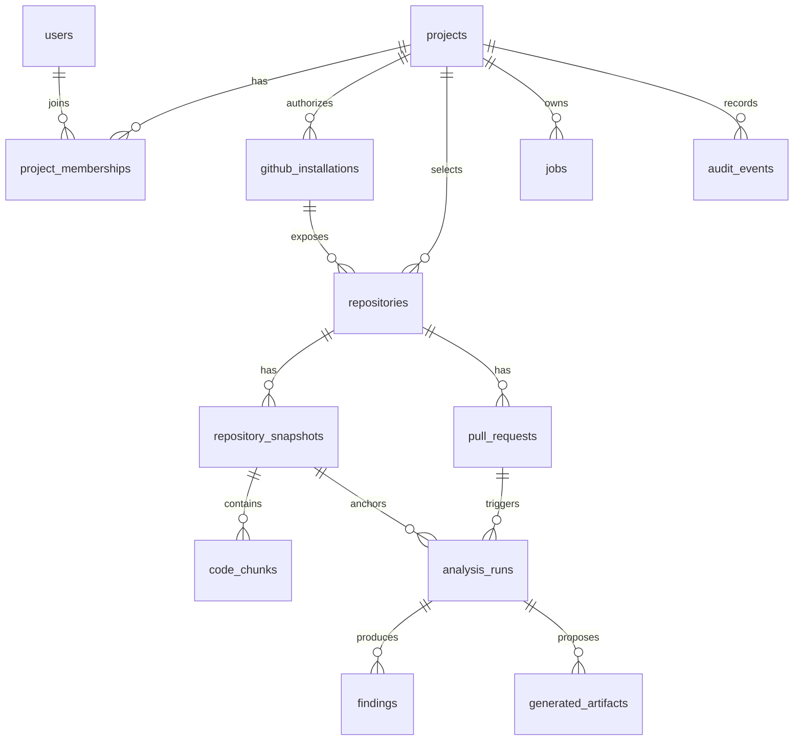

# Initial database design proposal

The full model below remains a future-stage proposal. Stage 1 has one Flyway migration, [`V1__foundation.sql`](../backend/src/main/resources/db/migration/V1__foundation.sql), defining only the tables needed by the current backend. It applied successfully to a fresh local PostgreSQL 18.6 database; Flyway history shows version 1 successful.

### Stage 1 tables

| Table | Purpose and constraints |
| --- | --- |
| `users` | Local account; normalized unique email, BCrypt hash, status, timestamps. |
| `refresh_tokens` | SHA-256 token hash, user FK, expiry, revocation, replacement pointer. |
| `projects` | Owner FK, globally unique slug, soft-delete timestamp. |
| `project_memberships` | Unique project/user pair; checked OWNER, ADMIN, MEMBER role. |
| `github_installations` | Unique GitHub installation ID and safe account metadata. |
| `project_github_installations` | Project-to-installation association with composite key. |
| `github_connection_states` | Single-use, expiring OAuth state hash tied to user, project, and intended installation. |
| `project_repositories` | Unique project/repository pair and foreign key to the associated installation. |

All primary IDs are UUIDs except external GitHub IDs, which are `BIGINT`. The project owner and OWNER membership are created in one transaction. Soft deletion preserves project relationships. Full cross-row consistency for owner membership is enforced in the application, with foreign keys protecting references; an administrative SQL change could still violate it.

### Future logical model

| Entity | Key fields and constraints | Notes |
| --- | --- | --- |
| `users` | `id`, external identity subject unique, display name, email (nullable) | Identity provider subject is authoritative; no plaintext credentials. |
| `projects` | `id`, name, owner user ID, settings | Tenant/security boundary. |
| `project_memberships` | project ID + user ID unique, role, status | Roles such as owner/admin/member/viewer; all access checked through this table. |
| `github_installations` | project ID, GitHub installation ID unique within connection model, account metadata, status | Store no long-lived installation token; private key is secret-managed. |
| `repositories` | project ID, installation ID, GitHub repository ID, owner/name, visibility, selection status | Unique `(project_id, github_repository_id)`; same GitHub repo may be selected into multiple projects with separate indexes. |
| `repository_snapshots` | project ID, repository ID, commit SHA, indexing state, timestamps | Unique `(repository_id, commit_sha)`; immutable source revision. |
| `code_chunks` | project ID, snapshot ID, path, start/end lines, content hash, embedding vector | Unique chunk key per snapshot; vector dimension tied to model version, with separate index/reindex plan. Minimize retained plaintext. |
| `pull_requests` | project ID, repository ID, GitHub PR number, base/head SHAs, state | Unique `(repository_id, github_pr_number)`; update metadata while analysis runs remain pinned. |
| `analysis_runs` | project ID, snapshot or PR ID, kind, source SHA(s), status, analyzer/model versions, timestamps | Durable provenance and idempotency key. |
| `findings` | project ID, analysis run ID, category, severity, path/line range, rule ID, message, fingerprint | Keep evidence and provenance; deduplicate by fingerprint per run. |
| `generated_artifacts` | project ID, run ID, kind, patch reference, review status | Generated tests are proposals, not executed results. |
| `jobs` | project ID, kind, payload reference, state, attempt count, lease, idempotency key | PostgreSQL is authoritative; Redis signals workers. |
| `outbox_events` | aggregate reference, event type, payload reference, delivery state | Transactional handoff for asynchronous work. |
| `audit_events` | project ID nullable for account events, actor ID, action, target type/ID, outcome, timestamp, correlation ID | Append-only metadata; no source or secret values. |

## Isolation and retention

- Include `project_id` directly on high-volume/search tables even when reachable through a parent, to make scoped queries and indexes explicit. Enforce consistency with composite foreign keys or validated writes.
- Every query, including vector search and background jobs, filters by authorized `project_id`; add database row-level security later if it adds defense in depth without obscuring application authorization.
- Index `(project_id, repository_id)` and `(project_id, snapshot_id)` on relevant tables. Start with exact vector search; add HNSW only after measured need and test tenant filtering.
- Define retention periods before persisting code chunks, prompts, and generated patches. Deleting a project must cascade or schedule secure deletion of all derived data and cache entries.
- Apply schema changes with Flyway from the Spring deployment. The Stage 0 init script only creates the `vector` extension in a fresh local database.
